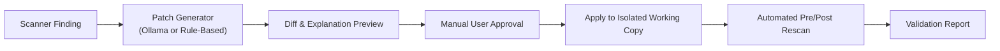

# Local Model and Offline Repair Engine Setup

This document outlines the local-only AI repair architecture, which operates without cloud APIs or API keys.

---

## 1. Local AI Philosophy & Constraints

- **Zero Cloud Invocations:** The system makes NO calls to OpenAI, Anthropic, Gemini, or external servers.
- **Zero API Keys:** No user tokens or API secrets are requested, accepted, or stored.
- **Two Execution Modes:**
  1. **Mode A: Local Ollama (Self-Hosted):** If the user has Ollama running locally on `http://127.0.0.1:11434`, the system detects installed local models (such as `qwen2.5-coder:1.5b`) and prompts them locally.
  2. **Mode B: Rule-Based Deterministic Repair Engine:** If Ollama is not installed or running, the system utilizes built-in AST and regex pattern repair rules developed specifically for the C-family vulnerability categories identified in the paper.

---

## 2. Setting Up Local Ollama (Optional)

1. **Verify Ollama Installation:**
   ```powershell
   ollama --version
   ```
2. **List Available Models:**
   ```powershell
   ollama list
   ```
   *(Note: The current environment already has `qwen2.5-coder:1.5b` installed and ready).*
3. **Pulling Additional Local Models (Optional):**
   ```powershell
   ollama pull qwen2.5-coder:1.5b
   # or
   ollama pull codellama:7b
   ```
4. **Ensure Ollama Service is Running:**
   ```powershell
   ollama serve
   ```
   The backend checks `http://localhost:11434/api/tags` to discover available models.

---

## 3. Deterministic Rule-Based Repair Patterns

When operating in offline rule-based mode, the engine contains verified mitigations corresponding to the findings in the research paper:

1. **CWE-120 / CWE-119 (Buffer Overflow):**
   - Replaces unbounded `strcpy`, `strcat`, `gets` with safe bounded alternatives (`strncpy`, `strncat`, `fgets`).
   - Replaces unconstrained `sprintf` with `snprintf(buf, sizeof(buf), ...)`.
2. **CWE-327 (Weak Cryptographic Randomness):**
   - Replaces insecure `srand()` and `rand()` in C++ with modern `<random>` library routines:
     ```cpp
     std::random_device rd;
     std::mt19937 gen(rd());
     ```
     *(Matches Listing 8 of the research paper).*
3. **CWE-665 (Improper Initialization):**
   - Identifies class constructors missing initialization of member variables (such as `balance` in `BankAccount`) and adds explicit constructor initializer lists:
     ```cpp
     BankAccount() : balance(0.0) {}
     ```
     *(Matches Listing 7 of the research paper).*
4. **CWE-78 (OS Command Injection):**
   - Flags unsanitized `std::system()` calls and encapsulates execution with sanitized parameter validation.
5. **CWE-20 (Improper Input Validation):**
   - Injects bounds checks and null pointer guard assertions.

---

## 4. Patch Safety Lifecycle



- **Backups:** The original file is backed up before any patch is written.
- **Explicit Approval:** No patch is written to disk without the user clicking **"Approve & Apply Patch"**.
- **Rescanning:** The modified file is re-evaluated by the static scanner to verify whether the target warning was eliminated or if new issues were introduced.
