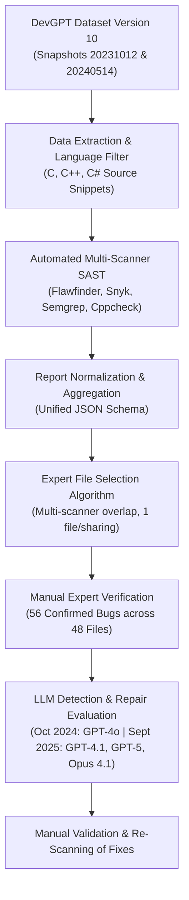

# Research Methodology

This document outlines the end-to-end experimental methodology developed by Belozerov, Barclay, and Sami (2026) in *"Secure coding with AI – from detection to repair"* and implemented in this project.

---

## 1. High-Level Dataflow Architecture

The study workflow comprises six systematic stages:

---

## 2. Dataset Preprocessing & Ingestion

1. **Source Exploration:** The DevGPT dataset curates real developer-ChatGPT interactions shared via Hacker News and GitHub (issues, PRs, commits, code files).
2. **Snapshot Tracking:** Two release snapshots were extracted:
   - `snapshot_20231012` (October 2023)
   - `snapshot_20240514` (May 2024)
   *Note:* Updates in DevGPT are non-incremental; some files from 2023 are absent in 2024.
3. **Language Selection:** Focused strictly on C-family systems languages (C, C++, C#) due to their prominence in memory-sensitive, systems, and performance-critical software.
4. **Code Extraction:** Only raw code blocks inside conversations were extracted into isolated files on disk. Conversational text and prompts were isolated to avoid skewing scanner results.
5. **Metrics Accounting:** Line counts and file counts were calculated using the standard `cloc` tool.

---

## 3. Static Code Security Scanners

Four complementary scanners were selected based on language coverage and availability:
- **Flawfinder (v2.0.19):** Specialized lexical/syntactic analyzer for C/C++ security vulnerabilities (buffer overflows, format strings).
- **Semgrep (v1.87.0):** Rule-based semantic AST scanner for C, C++, and C#.
- **Snyk (v1.1294.0):** Static code engine supporting C, C++, and C#.
- **Cppcheck (v2.14.0):** Dedicated C/C++ static analysis engine emphasizing undefined behavior and memory leaks.

---

## 4. Selection Algorithm for In-Depth Analysis

Because running in-depth LLM evaluations and manual verification on thousands of files is labor-intensive, the authors defined a transparent selection procedure:
1. **Candidate Pool:** Every file must have at least one detection from at least one scanner.
2. **Overlap Prioritization:** Priority given to files where multiple scanners flagged an issue on the exact same line.
3. **Sharing Deduplication:** DevGPT sharings may contain multiple conversational steps; exactly one representative file (typically from the final step) is chosen per sharing.
4. **Cross-Snapshot Deduplication:** Sharings duplicated between snapshot 1 and snapshot 2 are excluded using their canonical sharing URLs.
5. **Selected Cohort:**
   - **October 2024:** 64 files selected from `snapshot_20231012` (yielding 32 confirmed vulnerabilities in 26 files).
   - **September 2025:** 114 files selected from both snapshots (yielding 56 confirmed vulnerabilities in 48 files).

---

## 5. Manual Verification & CWE Cataloging

- Findings were manually reviewed by the first author and cross-validated by the co-authors.
- Benign warnings (e.g., safe `printf("%s", const_str)`, safe `memcpy` preceded by explicit bounds checking) were classified as **False Positives**.
- Confirmed flaws were mapped to MITRE Common Weakness Enumeration (CWE) numbers and cross-referenced with the **2024 CWE Top 25 Most Dangerous Software Weaknesses**.

---

## 6. Prompting & LLM Evaluation

- **Zero-shot prompting:** Prompts requested the LLM to act as a senior software security engineer, detect vulnerabilities, provide formal CWE numbers, and output fixed code in a single fragment.
- **Evaluation Criteria:**
  - **Detection (Dt):** Did the model accurately identify the security weakness?
  - **Fixing (Fx):** Did the proposed code eliminate the vulnerability without introducing severe regressions or syntax errors?
